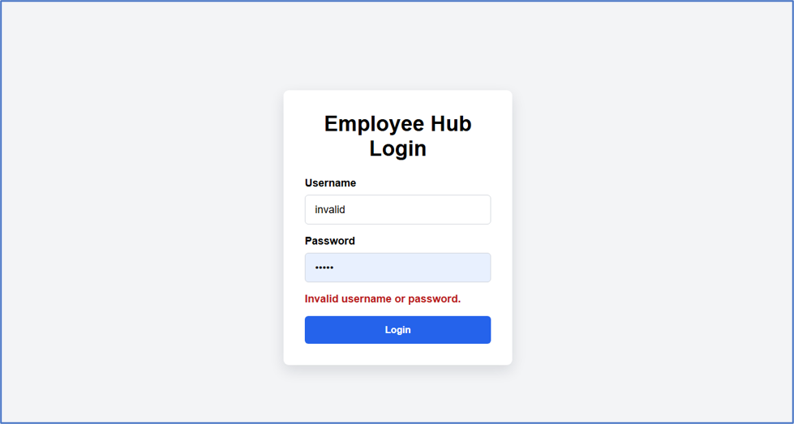
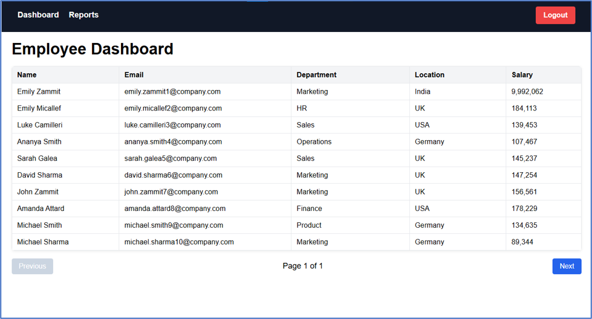
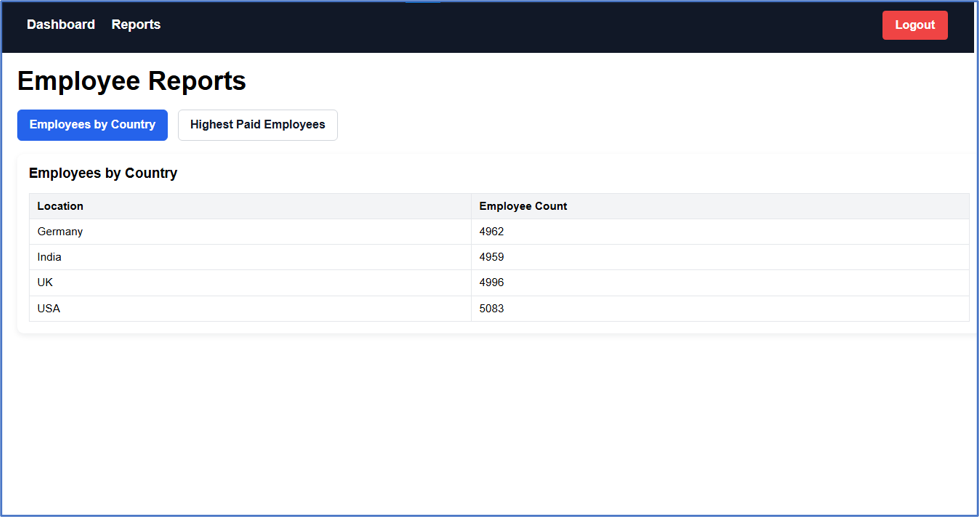
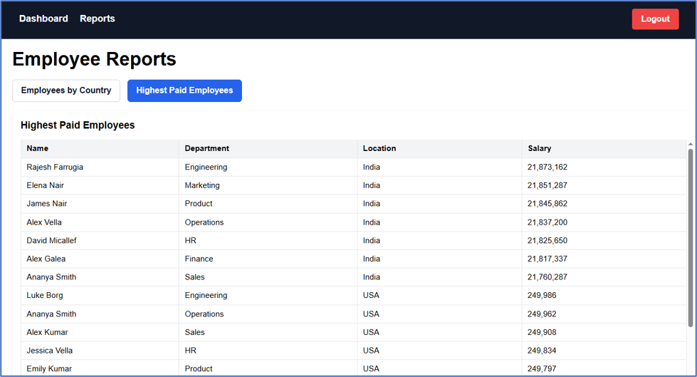

# Employee Hub UI

This project is a Spring Boot application that packages an Angular frontend and serves it as a single Java/JAR application.

## Architecture

- The Angular app lives in the `ui/` directory.
- The Java app lives in the project root and is built with Spring Boot.
- During Maven build, the Angular app is compiled with Node/NPM and the production output from `ui/dist/ui/browser` is copied into the Spring Boot jar under `static/`.
- When the jar starts, Spring Boot serves `index.html` from the embedded static files.
- UI API requests such as `/api/employees` are handled by the Java controller layer in this application (`EmployeeController`), which forwards them to the downstream service via `EmployeeRestClient`.
- The downstream base URL is configured with `employee.hub.service.base-url` and defaults to `http://localhost:9090` in development and `http://employee-hub-svc:9090` in containerized deployment.

In other words:

- Browser loads `http://localhost:8080/` -> Spring Boot serves the Angular `index.html`
- Browser calls `/api/...` -> Java controller in the UI layer -> downstream service call -> JSON response returned to UI


## Application UI Screenshots

These screenshots show the user experience in both negative and positive flows.

### Negative case: invalid login



The UI shows the validation message when a username/password combination is rejected.

### Positive case: successful dashboard after login



After logging in with the correct credentials (`admin` / `admin`), the dashboard loads employee data.

### Positive case: reports view




The reports page displays the employee counts and highest-paid employee data after authentication.

## Angular setup and frontend build

The Angular app is created under `ui/` and uses the standard Angular CLI flow:

```bash
cd ui
npm install
npm start
```

`npm start` runs:

```bash
ng serve --port 4200 --proxy-config proxy.conf.js
```

The `proxy.conf.js` file proxies `/api` requests from the Angular dev server to the Java UI app running on `http://localhost:8080`.

The production Angular build is triggered by Maven and runs as part of the Java packaging:

```bash
cd ui
npm run build
```

The compiled Angular dist output is then bundled into the Spring Boot jar.

## Maven / Java packaging

The root `pom.xml` installs Node/NPM via the frontend-maven-plugin, runs the Angular production build, and copies the generated frontend into the Spring Boot static resources directory.

Relevant behavior:

- `ui/dist/ui/browser` -> copied into the jar as `static/`
- Spring Boot serves that content as the application root
- `EmployeeController` exposes `/api` and calls the downstream service

This means the final app can be run as a normal Java Spring Boot project, not as a separate static web server.

## Run in standalone development mode

This is the normal local development flow for the Java UI app + downstream service:

1. Start the downstream service on port `9090`
2. Start the UI Java app on port `8080`
3. Start the Angular dev server on port `4200`

Example:

```bash
./mvnw spring-boot:run
```

Then, in a separate terminal:

```bash
cd ui
npm install
npm start
```

Open:

- Angular UI: `http://localhost:4200/`
- Java UI app: `http://localhost:8080/`
- API endpoint example: `http://localhost:8080/api/employees`

The `application-dev.yaml` file sets:

```yaml
employee:
  hub:
    service:
      base-url: http://localhost:9090
```

This allows the Java UI app to forward requests to the running downstream service.

## Run directly as a Java jar

Build the jar:

```bash
./mvnw clean package
```

Then run it:

```bash
java -jar target/employee-hub-ui-0.0.1-SNAPSHOT.jar
```

or with an explicit profile:

```bash
java -jar target/employee-hub-ui-0.0.1-SNAPSHOT.jar --spring.profiles.active=prod
```

The app will start on port `8080` by default and serve the Angular app from the jar itself. The UI app continues to proxy API calls to the configured downstream service via Java controllers.

## Docker build and run as standalone containers

Build the UI image from this repository:

```bash
docker build -t employee-hub-ui:v1 .
```

You also need the downstream service image, for example `employee-hub-svc:v1`, running on the same Docker network.

Create a shared Docker network:

```bash
docker network create employee-hub-network
```

Run the downstream service container:

```bash
docker run -d \
  --name employee-hub-svc \
  --network employee-hub-network \
  -p 9090:9090 \
  employee-hub-svc:v1
```

Run the UI container:

```bash
docker run -d \
  --name employee-hub-ui \
  --network employee-hub-network \
  -p 8080:8080 \
  -e SPRING_PROFILES_ACTIVE=prod \
  -e EMPLOYEE_HUB_SERVICE_BASE_URL=http://employee-hub-svc:9090 \
  employee-hub-ui:v1
```

Then open:

- UI: `http://localhost:8080/`
- Downstream service: `http://localhost:9090/`

The UI container reaches the downstream service through Docker DNS by using the service name `employee-hub-svc` instead of `localhost`.

## Docker Compose for UI + downstream service

This repo includes a `docker-compose.yaml` that creates a single shared Docker network and runs both containers together.

```bash
docker compose up --build -d
```

The compose file defines:

- `employee-hub-ui` on port `8080`
- `employee-hub-svc` on port `9090`
- a shared network named `employee-hub-network`

The UI service is configured with:

```yaml
employee.hub.service.base-url: ${EMPLOYEE_HUB_SERVICE_BASE_URL:-http://employee-hub-svc:9090}
```

This means the Java UI controller resolves API requests by calling the downstream service container on the Docker network while the browser still interacts with the UI at `http://localhost:8080`.

To stop everything:

```bash
docker compose down
```

## Release Cycles / Evolution Notes

### Release Cycle 1: Standalone JAR execution of UI and SVC projects

Evolution / Release Notes:

- This is the first operational model: each project runs independently as a Java process.
- The service project exposes the backend API on port `9090`.
- The UI project runs as a Spring Boot application on port `8080` and serves the packaged Angular app from the jar.
- The UI Java layer calls the service project through `employee.hub.service.base-url`, typically `http://localhost:9090` in local development.
- This mode is best for local development, debugging, and testing without Docker.

Typical flow:

```bash
# service project
./mvnw spring-boot:run

# ui project
./mvnw spring-boot:run
```

Access:

- UI: `http://localhost:8080/`
- Service: `http://localhost:9090/`

This release validates the contract between UI and backend before any containerization.

### Release Cycle 2: Docker image standalone containers with a manual bridge network

Evolution / Release Notes:

- The second evolution packages each app into its own Docker image.
- Containers are started manually and connected through a user-created bridge network.
- This isolates runtime dependencies and makes the app portable across hosts.
- The UI container calls the service container by Docker DNS name, not by `localhost`.

Manual setup example:

```bash
docker network create employee-hub-network

docker run -d \
  --name employee-hub-svc \
  --network employee-hub-network \
  -p 9090:9090 \
  employee-hub-svc:v1

docker run -d \
  --name employee-hub-ui \
  --network employee-hub-network \
  -p 8080:8080 \
  -e SPRING_PROFILES_ACTIVE=prod \
  -e EMPLOYEE_HUB_SERVICE_BASE_URL=http://employee-hub-svc:9090 \
  employee-hub-ui:v1
```

This release proves that UI and service can run separately while still communicating on a shared Docker network.

### Release Cycle 3: Docker Compose orchestration for UI + service

Evolution / Release Notes:

- The third evolution introduces orchestration using Docker Compose.
- Compose creates the network automatically, starts both services together, and wires internal service-to-service communication.
- It is the preferred deployment model for local multi-container environments and test stacks.
- Optional scaling can be used for replicas when needed, for example multiple UI instances behind the same backend topology.

Example:

```bash
docker compose up --build -d
```

Optional scale example:

```bash
docker compose up --build -d --scale employee-hub-ui=2
```

Compose config provides:

- a shared network named `employee-hub-network`
- UI access at `http://localhost:8080/`
- service access at `http://localhost:9090/`
- internal DNS-based service communication using `employee-hub-svc`

This release is the standard deployment pattern for running both apps as a single logical stack.

## Summary

This application is designed so the Angular frontend is built, bundled, and served by a single runnable Java Spring Boot jar. The UI layer acts as a gateway: the web app loads from Spring Boot static content, while `/api` requests are forwarded through Java controller code to a downstream service. The same app can be run locally with Maven, directly as a jar, or in Docker as either independent containers or a Docker Compose stack.
